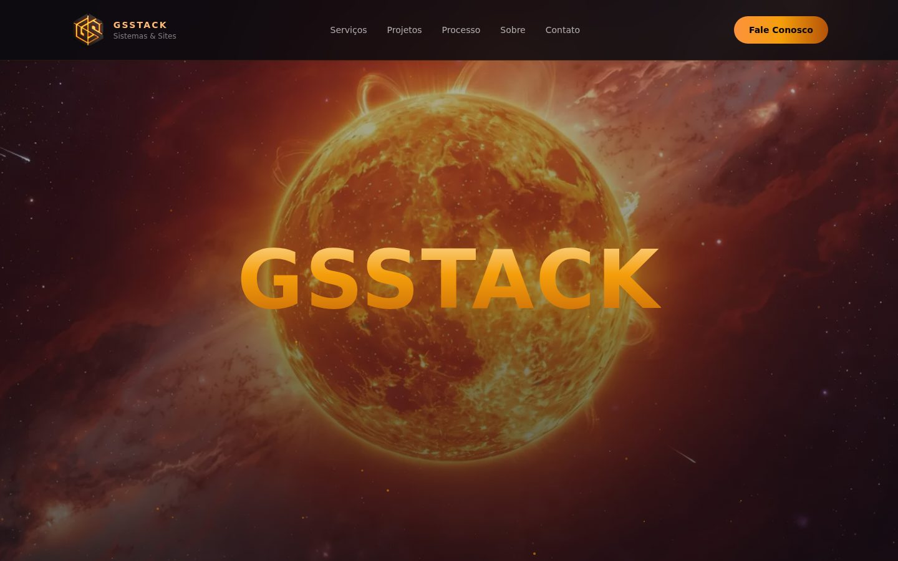

# GSSTACK · Site institucional

Site da GSSTACK, estúdio de desenvolvimento de sistemas web, sites, automações e integrações de APIs.

🔗 **No ar:** [gsstack.com.br](https://gsstack.com.br)



## Destaques

- Página única com seções de serviços, projetos, processo de trabalho, sobre e contato
- Hero com vídeo de fundo e animações de entrada
- Vitrine de projetos reais, incluindo o StockSys, sistema de controle de estoque e pedidos
- Layout responsivo para celular e desktop
- Imagens em WebP e build otimizado com Vite

## Stack

- Vue 3
- Vite
- Tailwind CSS, PostCSS e Autoprefixer

## Rodando localmente

```bash
npm install
npm run dev     # ambiente de desenvolvimento
npm run build   # gera o build em dist/ e copia os arquivos publicados para a raiz
```

---

Desenvolvido por **Giovani Storani Jacon** · [LinkedIn](https://www.linkedin.com/in/giovani-jacon) · [Portfólio](https://giovani.gsstack.com.br)
